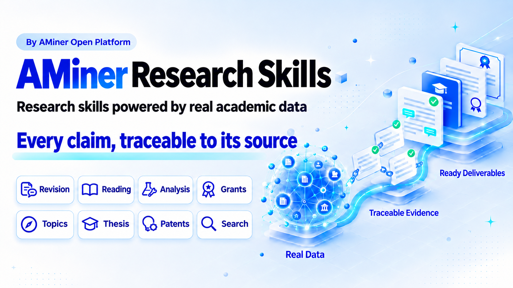

<div align="center">
  <h1>AMiner Research Skills</h1>
  <p>
    <a href="LICENSE"></a>
    <a href=".claude-plugin/marketplace.json"></a>
    <a href="SKILLS.en.md"></a>
    <a href="INSTALL.en.md"></a>
    <a href="README.md"></a>
  </p>
  <p>
    <a href="https://x.com/AMiner_Research"></a>
    <a href="https://bsky.app/profile/aminerzp.bsky.social"></a>
    <a href="assets/wechat-official-account-qrcode.png"></a>
    <a href="assets/wechat-service-account-qrcode.png"></a>
    <a href="https://www.xiaohongshu.com/user/profile/62947ab80000000021029ebf"></a>
    <a href="https://www.weibo.com/u/1870858943"></a>
  </p>
  <p>
    <a href="https://www.aminer.cn/">Website</a>
    · <a href="#use-online-research-workflow-skills">Use online</a>
    · <a href="SKILLS.en.md">Skill Catalog</a>
    · <a href="INSTALL.en.md">Installation</a>
    · <a href="https://open.aminer.cn/open/docs">Open Platform Docs</a>
    · <a href="README.md">中文</a>
  </p>
  <p>
    
  </p>
  <p>
    <b>AMiner web app: Smart Search, AI Reading, Res Labs, AI2000 and more built in — visit <a href="https://www.aminer.cn">https://www.aminer.cn</a></b>
  </p>
</div>

---

`aminer-research-skills` collects reusable research skills built on AMiner academic data for the full research lifecycle, emphasizing real academic data, verifiable evidence chains, and directly usable research artifacts.

## Use online: research workflow skills

The following 8 skills can be used directly in the AMiner web app: click the button on the right to open one, no installation needed. They can also be installed to a local agent, see [Installation Guide](INSTALL.en.md).

| Skill | What it does | Try&nbsp;online |
|---|---|:---:|
| **Manuscript writing and revision** | Draft with real citations, mock review, reply to reviewers | [](https://www.aminer.cn/?skill=aminer-paper-writing) |
| **In-depth paper reading** | Close reading, line-by-line translation, reproduction audits | [](https://www.aminer.cn/?skill=aminer-paper-deep-reading) |
| **Experiment analysis and results writing** | Debug experiments, write up results, verify methods | [](https://www.aminer.cn/?skill=aminer-experiment-to-paper) |
| **Grant proposal writing** | Parse the call, frame the question, draft, mock review | [](https://www.aminer.cn/?skill=aminer-grant-application) |
| **Topic selection** | Assess competition and novelty; compare topics and settle on one | [](https://www.aminer.cn/?skill=aminer-topic-selection) |
| **Advisor selection** | Enumerate a department's advisors, build profiles, compare, draft contact emails | [](https://www.aminer.cn/?skill=aminer-advisor-selection) |
| **Thesis: proposal to defense** | Proposal novelty check, chapter drafting, defense prep | [](https://www.aminer.cn/?skill=aminer-thesis-writing) |
| **Patents and technology intelligence** | Tech surveys, prior-art search, claims, OA replies | [](https://www.aminer.cn/?skill=aminer-patent-tech-intelligence) |

## Local skills

The other 15 skills run in a local agent (Claude Code, Codex, OpenClaw, and others); see [Quick install](#quick-install) below. Follow the link after each category for full details and example prompts.

**Search and discovery** · [Examples and details →](SKILLS.en.md#search-and-discovery)

- [`aminer-free-academic`](skills/aminer-free-academic/SKILL.md): Free lookups of papers, scholars, institutions, venues, and patents
- [`aminer-academic-search`](skills/aminer-academic-search/SKILL.md): Full academic data queries (29 APIs), including structured experiment data
- [`aminer-daily-paper`](skills/aminer-daily-paper/SKILL.md): Paper recommendations by topic or scholar profile
- [`aminer-deep-search`](skills/aminer-deep-search/SKILL.md): Collect hundreds of candidate papers for a survey
- [`sota-finder`](skills/sota-finder/SKILL.md): Find SOTA results and build sourced leaderboards

**Reading and organizing** · [Examples and details →](SKILLS.en.md#reading-and-organizing)

- [`aminer-pdf-ocr`](skills/aminer-pdf-ocr/SKILL.md): Convert paper PDFs to full-text Markdown
- [`aminer-exp-extraction`](skills/aminer-exp-extraction/SKILL.md): Extract experiment details from paper Markdown as JSON
- [`scientific-taxonomy`](skills/scientific-taxonomy/SKILL.md): Organize a set of papers into a hierarchical taxonomy
- [`paper-source-trace`](skills/paper-source-trace/SKILL.md): Trace claims to cited sources and draw citation maps

**Research reports** · [Examples and details →](SKILLS.en.md#research-reports)

- [`deep-research`](skills/deep-research/SKILL.md): Write cited research reports with a traceable evidence ledger

**Manuscript coverage checks** · [Examples and details →](SKILLS.en.md#manuscript-coverage-checks)

- [`baseline-finder`](skills/baseline-finder/SKILL.md): Check whether a paper misses baselines it should compare against
- [`related-work-audit`](skills/related-work-audit/SKILL.md): Check a paper for potentially missing related work

**Citation checking** · [Examples and details →](SKILLS.en.md#citation-checking)

- [`pdf-citation-verifier`](skills/pdf-citation-verifier/SKILL.md): Verify that the references in a paper PDF actually exist
- [`structured-reference-audit`](skills/structured-reference-audit/SKILL.md): Conservative reference audit: unresolved does not mean fabricated
- [`citation-faithfulness`](skills/citation-faithfulness/SKILL.md): Check whether citations faithfully represent their sources

## Quick install

**1. Install skills** (requires Node.js 18+; replace `--skill` with the skills you need, or `'*'` for all):

```bash
npx skills add AMinerOrg/aminer-research-skills --agent claude-code --skill aminer-free-academic --yes
```

Claude Code users can also install as plugins, which also registers each skill's slash commands:

```text
/plugin marketplace add AMinerOrg/aminer-research-skills
/plugin install aminer-free-academic@aminer-research-skills
```

**2. Configure the token**: generate one in the [AMiner Console](https://open.aminer.cn/open/board?tab=control) and set it in the agent's environment:

```bash
export AMINER_API_KEY="<YOUR_TOKEN>"
```

**3. Start using**: describe your task in plain language and the agent picks the right skill.

Manual install, Python dependencies, OpenClaw setup, and billing notes are in the [Installation Guide](INSTALL.en.md).

## Feedback and contact

- Usage questions and bugs: [GitHub Issues](https://github.com/AMinerOrg/aminer-research-skills/issues)
- Email: [report@aminer.cn](mailto:report@aminer.cn)
- API access and billing: [AMiner Open Platform](https://open.aminer.cn/open/docs)
- Contributing: [Contributing guide](CONTRIBUTING.en.md)


## Star History

[](https://star-history.com/#AMinerOrg/aminer-research-skills&Date)
